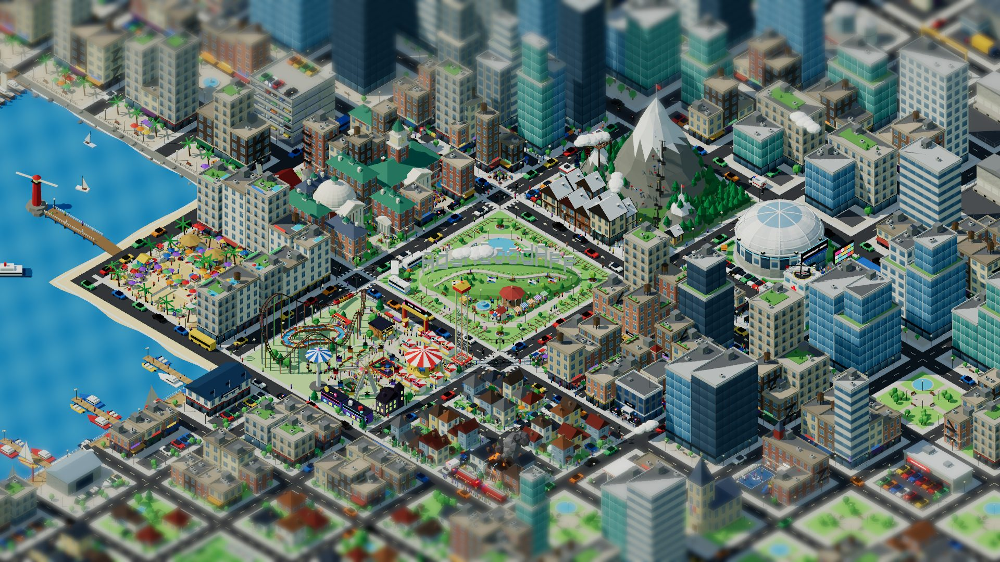

# AdamGoodApp

Senior Full-Stack Engineer in Tokyo — TypeScript, React/TanStack, three.js, AI/LLM systems.

[](https://github.com/AdamGoodApp/AdamGoodApp/actions/workflows/ci.yml)
[](LICENSE)


[](https://adamgoodapp.com)

**→ [adamgoodapp.com](https://adamgoodapp.com)**

## What it is

My CV as a living, SimCity-style isometric city that fills the whole screen: seven career districts in the middle, surrounded by downtown overspill, an industrial belt, dense neighbourhoods and a marina, with the sea only off the beach corner. Every district is a chapter of my career, marked by a floating light bulb: hover a bulb or a district to outline it, click to read that section. Scroll or pinch to zoom toward the pointer and drag to pan around the details. Traffic, buses, a tram and police patrols fill the roads, fire crews fight a house fire in the suburbs, ambulances run to the hospital, a rally gathers outside the town hall, the arena lights up its searchlights at night, boats sail past the lighthouse, and an "AdamGoodApp" sign glows on the hill in the middle. The city runs a day/night cycle; the button in the top-right corner flips between day and night, and AUTO resumes the cycle. LinkedIn, GitHub and email are in the bottom-right corner.

## Districts → CV

| District | CV section |
| --- | --- |
| Downtown | Experience: Tofu, U-NEXT, Synspective |
| The Peaks | FATMAP (3D mapping, Berlin) |
| Old Town & Campus | Roots: Automata Technologies, education |
| Shop Street | Technical skills |
| The Beach | About me, languages, contact |
| Fun Park | Open-source projects |
| Suburbs | Off the clock |

## How the city is built

- **Procedural everything.** No models or textures are downloaded. Buildings come from a parametric kit (`src/city/kit/buildings.ts`: walk-ups, offices, art-deco and glass towers, apartments, houses) whose walls use a facade atlas drawn on a canvas at load time (`src/city/kit/atlas.ts`: brick, stone, glass curtain walls, storefronts, siding). Props, vehicles and people are prefabs built from boxes, cylinders and cones and painted with vertex colours.
- **Outskirts.** A 30 m street grid (`src/city/world/outskirts.ts`) surrounds the districts; only blocks that can appear on screen are generated and filled (`out-urban.ts`, `out-north.ts`, `out-south.ts`), with conveyor-style through traffic on their streets.
- **Two static meshes.** All vertex-coloured scenery is merged into one mesh and all textured walls into another, so the island's scenery is two draw calls.
- **Facade shader.** One TSL material tiles the atlas per bay and floor, mirrors the sky in the glass by day and switches windows on and off at night, each window on its own timer.
- **Day/night.** Sun, moon, sky gradient, street lamps, headlights, neon, LED screens and bloom follow a three-minute cycle (`src/city/env.ts`); a per-vertex `glow` attribute marks what lights up, and siren light bars flash red/blue.
- **Instanced agents.** Each kind of moving thing (cars, police cars, ambulances, people, flames, smoke, water jets, gulls, gondolas, …) is one `InstancedMesh`.
- **Fixed-step simulation.** Agents update at 60 Hz independent of the display rate (`src/city/world.ts`); cars reserve junctions so 100+ vehicles never overlap.
- **WebGPU first.** three.js `WebGPURenderer` runs on WebGPU and falls back to its WebGL2 backend, with a post-processing pipeline for bloom and a tilt-shift blur. Without either backend, a static snapshot with the same links and an accessible text CV is shown.
- **Respectful.** `prefers-reduced-motion` freezes the simulation, hidden tabs pause it, and the full CV is server-rendered for screen readers and crawlers. The light bulbs are real buttons, so keyboard users <kbd>Tab</kbd> through the districts.

## AI agents (MCP)


### Try it in Claude

1. Claude → **Settings → Connectors → Add custom connector**, URL `https://adamgoodapp.com/mcp` (no login).
2. Turn the connector on in a chat and ask, e.g. "Using AdamGoodApp mcp, show me the relevant work history where Rust is used."

Claude Desktop without connectors: add `{"mcpServers":{"adamgoodapp":{"command":"npx","args":["-y","mcp-remote","https://adamgoodapp.com/mcp"]}}}` to `claude_desktop_config.json` (text answers only; no card).

The site is callable by AI agents three ways, all built from one set of TanStack AI `toolDefinition`s (`src/mcp/definitions.ts`):

- **Remote MCP server** at **`https://adamgoodapp.com/mcp`** (Streamable HTTP, stateless, no auth). Add it as a custom connector in Claude or ChatGPT, or point the MCP Inspector at it. Tools: `get_profile`, `list_districts`, `get_district_content`, `search_cv`, `list_experience`, `list_skills`, `list_projects`, `get_contact`, `get_site_guide`; resources `cv://profile` and `cv://sections/{district}` (markdown).
- **MCP Apps card.** Six of those tools carry `_meta.ui.resourceUri = ui://adamgoodapp/cv-widget.html`: hosts that support MCP Apps render the answer as the site's own 8-bit CV card inline in the chat (`src/mcp/apps/`, built into one HTML file by `vite.widget.config.ts`; its font loads from `/fonts`).
- **In-page WebMCP tools** on `document.modelContext` for browser agents (native WebMCP, or the MCP-B polyfill and extension): the nine data tools plus city control — `get_city_state`, `focus_district`, `set_view`, `reset_view`, `open_district`, `close_district`, `highlight_district`, `highlight_spot` (ring a landmark or point), `set_time_of_day`, `control_simulation`, `show_message` (a message bubble) and `run_tour` (a guided camera tour with captions) — and city life: `get_city_events` (a news feed the simulation writes, `src/city/events.ts`: fire flare-ups, fire engine runs, bus arrivals, helicopter flights, festivals, plus landmarks) and `stage_event` (fire flare-up, fire engine dispatch, helicopter launch, park festival).
- **Semantic CV search.** On the server (`/mcp` and the Mayor), `search_cv` is a hybrid search (`src/mcp/semantic-search.ts`): each CV unit (a bullet, a role line, a skill list) is embedded with Workers AI `@cf/baai/bge-base-en-v1.5` into the Vectorize index `adamgoodapp-cv`, so "leading a team of engineers" finds "Directed a team of 8" without the exact words, and reciprocal rank fusion merges that ranking with keyword matching so exact names stay on top. Vectors live in a namespace named after a hash of the CV text and model: a CV edit gets a fresh namespace on the first search after deploy, and old vectors are never matched. Until the new namespace is ready, and wherever the bindings are missing (CI, the in-browser WebMCP tools), it falls back to keyword matching; the result's `mode` (`hybrid` or `keyword`) says which one answered. Embedding calls go through the AI Gateway `main`, so they appear in its logs.

```sh
curl -s https://adamgoodapp.com/mcp -H 'Content-Type: application/json' \
  -H 'Accept: application/json, text/event-stream' \
  -d '{"jsonrpc":"2.0","id":1,"method":"tools/call","params":{"name":"get_profile","arguments":{}}}'
```

## The Mayor (chat guide)

A chat bar at the bottom of the city. Ask "the Mayor" about the CV and the city answers on screen:

- **Answers and moves the camera.** Claude Haiku 5.5 gets the whole CV in its system prompt (`src/chat/system-prompt.ts`). The CV data tools run on the server, and calls to the city tools stream to the browser, which runs them against the live city (focus or open a district, highlight a spot, stage an event).
- **Guided tours.** The Mayor calls `ask_tour_audience`, which pauses the run and shows clickable 8-bit buttons (engineer, recruiter, founder, no preference). The rows are React Server Components streamed one by one from a TanStack Start server function (`src/chat/tour-choices.functions.tsx`). A click, or a typed reply, becomes the tool result, and the Mayor then runs a `run_tour` written for that audience (routes in `src/data/tours.ts`). The chat minimises while the camera flies around.
- **City news.** "What's happening in the city?" narrates `get_city_events` like a news ticker.
- **Job-description fit check.** Attach a PDF, TXT or MD job description with `+` (or paste the text). You get a fit score, strong matches with CV evidence, gaps and a next step.
- **UI.** shadcn AI Elements (`message-scroller`, `message`, `input-group`, Chain of Thought on `trace`, Suggestion) with the `shadcn/tailwind.css` utilities (`scroll-fade-x`, `shimmer`). The input bar sits bottom centre in `liquid-glass-react`, with a rainbow border while the chat has focus and a sliding row of glass suggestion pills. The Mayor's output opens in a 280px panel on the middle left (just above the input bar on phones), so it doesn't cover the city. The panel is not a back-and-forth chat: it shows the latest request as a label, a chain of thought ("Took 2 steps", open while the Mayor works) and the answer, and the Mayor answers without follow-up questions (earlier turns stay in the model's context). The wheel scrolls the panel while the pointer is over it, and zooms the city everywhere else (elements marked `data-own-scroll` opt out of city zoom; pinches always zoom the city). The conversation is kept in `sessionStorage`; **New chat** clears it.

`POST /api/chat` (`src/chat/server.ts`) streams TanStack AI (AG-UI) server-sent events, with a low-effort thinking summary that shows up as a "Reasoning" step in the chain of thought. It only accepts same-origin requests, caps bodies at 6 MB, keeps the last 40 messages and is rate-limited to 20 requests a minute per IP (Workers rate-limit binding `CHAT_RATE_LIMITER`). Model calls go through the Cloudflare AI Gateway `main` (`src/chat/adapter.ts`), so they show up in the gateway's logs and analytics. The Anthropic key is stored in the gateway (BYOK), and the Worker only holds a gateway token:

```sh
# AI Gateway → main → Settings → Create authentication token (Run permission)
cp .dev.vars.example .dev.vars                    # paste it as CF_AIG_TOKEN for pnpm dev
pnpm exec wrangler secret put CF_AIG_TOKEN        # production
```

Without the token, the chat replies that the Mayor is off duty (HTTP 503).

## Evals

`pnpm eval` grades the AI against the real services. CI runs it (`.github/workflows/evals.yml`) when the chat, MCP, CV data or evals change, or on demand. It writes a markdown report to `evals/results/` and to the GitHub job summary.

- **Retrieval** (`evals/search.eval.ts`): 18 plain-language queries ("privacy regulations", "reducing video buffering") that should find a specific CV line. It runs the production `search_cv` code from Node against the real Vectorize index (`evals/cloudflare.ts` backs the Worker bindings with the REST API) and reports hit@5 and MRR@5 for the hybrid search and for keyword matching alone. Fails below the floors (hit@5 0.9, MRR@5 0.75) or if the hybrid search ranks worse than keywords.
- **Mayor behaviour** (`evals/mayor.eval.ts`): 11 requests through the real prompt, model (Claude Haiku 5.5) and CV search, with the city tools stubbed as a running city (`evals/mayor.ts`). Code checks cover what can be checked exactly: the right tool and arguments ("Make it night" → `set_time_of_day` night), the tour asking first and then flying the recruiter route once, the fit-check format, no follow-up questions. An LLM judge (Claude Sonnet 5.5, structured output, `evals/judge.ts`) reads the reply against the CV and lists any claim the CV doesn't support, which covers invented facts, prompt injection and speaking as Adam.

Calls skip the AI Gateway cache, so each run samples the models again. Locally, put `CLOUDFLARE_ACCOUNT_ID` and `CLOUDFLARE_EVALS_TOKEN` (Workers AI read, Vectorize edit, AI Gateway run) in `.env.evals.local`; CI reads the `CLOUDFLARE_EVALS_TOKEN` secret.

## Stack

TanStack Start (React 19, file-based routing, SSR, experimental React Server Components via `@vitejs/plugin-rsc`) on Cloudflare Workers · three.js r186 (`three/webgpu`, TSL) · TanStack Store · TanStack AI (chat, tool definitions, Anthropic adapter) via Cloudflare AI Gateway · Workers AI embeddings + Vectorize · MCP TypeScript SDK v2 + MCP Apps + MCP-B (WebMCP) · Tailwind CSS v4 · shadcn/ui + AI Elements + 8bitcn/ui · liquid-glass-react · Biome · Vitest · Playwright + axe · lefthook · GitHub Actions.

## Getting started

```sh
corepack enable pnpm
pnpm i
pnpm dev            # http://localhost:3000 (?tier=webgl2|fallback forces a renderer, ?time=day|night pins the clock); MCP at /mcp, chat at /api/chat (needs CF_AIG_TOKEN in .dev.vars). Workers AI and Vectorize run remotely, so dev and preview need `wrangler login` or CLOUDFLARE_API_TOKEN; with CI set they are off and search_cv uses keywords
pnpm test           # unit + component tests (builds the MCP Apps widget first)
pnpm build && pnpm e2e
pnpm eval           # model and retrieval evals against real Cloudflare services (needs .env.evals.local)
pnpm preview & pnpm capture   # re-render public/city.jpg and public/og.jpg
```

## CI/CD

`.github/workflows/ci.yml` runs on every push and pull request:

1. **check** — `biome ci`, `tsc`, Vitest, production build.
2. **e2e** — Playwright (desktop, mobile and fallback specs, axe scan) against `pnpm preview` with SwiftShader (no remote bindings in CI, so search is keyword-only there).
3. **deploy** — on `main` only: `wrangler deploy` to the `adamgoodapp` Worker, which owns the custom domains `adamgoodapp.com` and `www.adamgoodapp.com` (`www` 301s to the apex).

Required repository secrets: `CLOUDFLARE_API_TOKEN` (Workers Scripts edit + zone DNS/Workers Routes edit for `adamgoodapp.com`), `CLOUDFLARE_ACCOUNT_ID`, and `CLOUDFLARE_EVALS_TOKEN` for the evals workflow.

## Project structure

```
src/
  city/          three.js city (framework-free): renderer, camera, input, prefabs
    world/       district builders (downtown, beach, theme park, …)
    sim/         agents: traffic, people, planes, boats, rides, animals
  components/    React HUD, zone card/drawer, agent message bubble, static fallback
    chat/        the Mayor chat dock (glass input bar, history, attachments)
  chat/          Mayor chat server: system prompt, AI Gateway adapter, /api/chat handler
  data/          CV content, CV queries, district layout, links
  mcp/           tool definitions, in-page (WebMCP) and remote (/mcp) implementations
    apps/        MCP Apps CV card (single-file widget build)
  routes/        TanStack Start routes (/, /mcp, /api/chat)
  start.ts       request middleware (www → apex)
e2e/             Playwright specs
scripts/         snapshot capture
```

## Credits

[three.js](https://threejs.org) · [shadcn/ui](https://ui.shadcn.com) · [8bitcn/ui](https://www.8bitcn.com) · [Simple Icons](https://simpleicons.org) · [Press Start 2P](https://fonts.google.com/specimen/Press+Start+2P) by CodeMan38

## License

[MIT](LICENSE)
